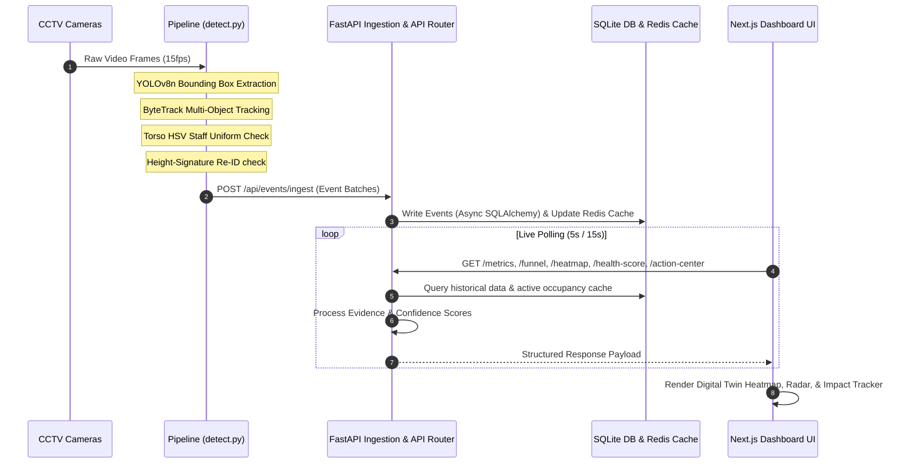
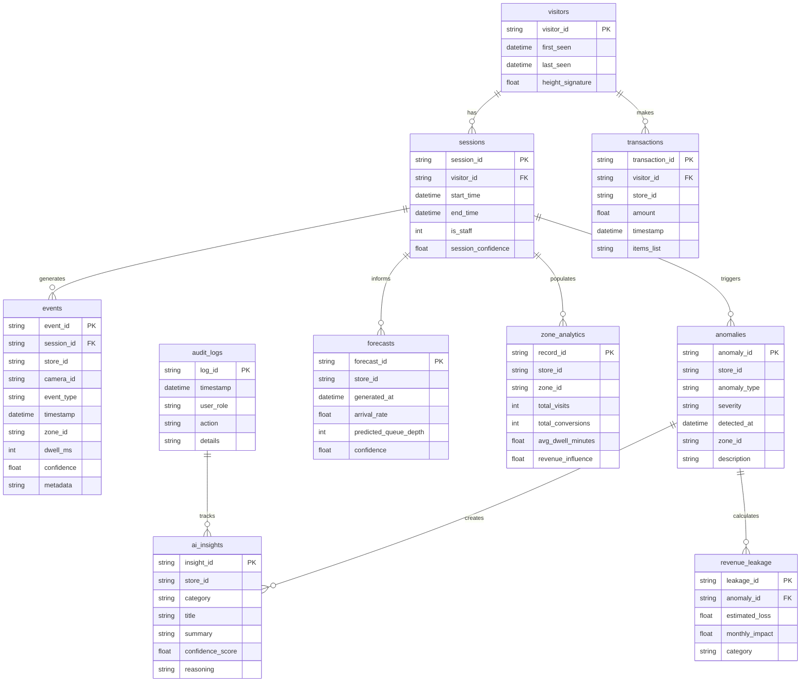

# hit-mapping
الگوی رفتاری افراد در یک مکان

---

> فروشگاه لباس (RTSP زنده، دو طبقه، ابزار ROI): [docs/CLOTHING_STORE_GUIDE.md](docs/CLOTHING_STORE_GUIDE.md)

# VisionRetail IQ — AI Retail Operating System

> **VisionRetail IQ** transforms raw CCTV footage into real-time retail intelligence, enabling store operators to understand customer behavior, optimize operations, reduce revenue leakage, and improve in-store conversion.
> 
> The platform combines Computer Vision, Event Streaming, Real-Time Analytics, Predictive Intelligence, and AI-powered decision support into a unified operational intelligence layer.


## 🚀 Core Capabilities

* **Visitor Detection & Tracking**: Integrates YOLOv8n and ByteTrack to track visitors in real-time.
* **Cross-Camera Identity Resolution**: Re-identifies visitors across cameras using bounding box height signatures within temporal constraints (rejects facial recognition to preserve privacy and face-blur compliance).
* **Advanced Staff Exclusion Engine**: Classifies store associates dynamically using HSV torso color-uniform matching and behavioral duration analysis.
* **Retail Digital Twin**: Renders interactive SVG store layout overlays highlighting customer walking trails, zone hotspots, dead zones, and queue congestion alerts.
* **AI Retail Executive Copilot**: Provides Llama-based natural language insights, daily performance reviews, and ranks operational revenue leakage.
* **Predictive Forecasting**: Computes expected queue depths, checkout times, and daily footfall using regression analytics.
* **Multi-Store Benchmarking**: Side-by-side performance comparison, conversion funnels, and revenue metrics (e.g. comparing Bangalore vs Mumbai store data).

## 🛠️ Technical Stack

| Category | Technologies Used |
|---|---|
| **AI & CV Pipeline** | Python · YOLOv8 · ByteTrack · OpenCV · NumPy |
| **Backend Service** | Python · FastAPI · Async SQLAlchemy · SQLite · Redis |
| **Frontend Web** | Next.js 14 App Router · React · Tailwind CSS · Recharts |
| **Infrastructure** | Docker · Docker Compose · Structured Logging · pytest |


## 📁 System Architecture



## 🛢 Database Design




## Event-Driven System Design

```
  [Edge Vision Pipeline] ──► [FastAPI Gateway] ──► [Redis Live Cache]
                                    │
                                    ▼
                             [SQLite Database]
```

To support a live user interface, the system employs an event-driven design:
* **Event Producers**: The edge video pipelines output JSONL files and POST batches to the API.
* **FastAPI Gateway**: Processes batches asynchronously and writes to the SQLite database.
* **Redis Caching**: Caches active visitor counts and spatial coordinates. This allows the Next.js dashboard to display live positions instantly without querying the relational database for coordinates.
* **Analytics Workers**: The API router acts as a query engine, running SQL queries to calculate metrics and update dashboard cards at 5-second and 15-second intervals.

## 🎯 Purplle Tech Challenge Alignment

VisionRetail IQ was built specifically to solve the end-to-end Store Intelligence problem:

✅ Raw CCTV → Structured Events
✅ Structured Events → Real-Time Analytics
✅ Real-Time Analytics → Business Intelligence APIs
✅ Business Intelligence APIs → Live Dashboard
✅ Multi-Store Retail Benchmarking
✅ Production-Ready Deployment via Docker

The platform directly addresses all major challenge requirements:

| Requirement | Implementation |
|-------------|----------------|
| Visitor Detection | YOLOv8 + ByteTrack |
| Entry/Exit Tracking | Direction-aware Tripwire System |
| Staff Exclusion | HSV Uniform Classification |
| Re-Entry Handling | Height Signature Re-ID |
| Event Streaming | JSONL Event Pipeline |
| Intelligence API | FastAPI |
| Real-Time Metrics | Analytics Engine |
| Anomaly Detection | Queue + Conversion Monitoring |
| Dashboard | Next.js Live Analytics UI |
| Containerization | Docker Compose |

## 📊 Business Questions VisionRetail IQ Answers

The platform transforms CCTV footage into actionable retail intelligence.

| Business Question | System Component |
|------------------|------------------|
| How many visitors entered today? | Footfall Analytics |
| What is today's conversion rate? | Funnel Engine |
| Which zone receives the highest attention? | Heatmap Engine |
| Which zones have high dwell but low purchase intent? | Funnel + Heatmap Correlation |
| Are queues increasing right now? | Queue Analytics |
| Is conversion lower than normal? | Anomaly Detection |
| Are customers abandoning billing queues? | Queue Abandonment Detection |
| Which store performs best? | Multi-Store Benchmarking |

## 🧠 Edge Cases Handled

Retail environments are noisy and unpredictable. VisionRetail IQ includes dedicated handling for:

| Edge Case | Solution |
|------------|-----------|
| Group Entry | ByteTrack individual tracking IDs |
| Staff Movement | HSV Uniform Classification |
| Customer Re-Entry | Height Signature Re-ID |
| Empty Store Periods | Zero-Traffic Safe Analytics |
| Queue Formation | Queue State Tracking |
| Queue Abandonment | Billing Correlation Engine |
| Camera Overlap | Cross-Camera Deduplication |
| Partial Occlusion | Confidence-Aware Tracking |
| Crowded Billing Zones | Queue Density Monitoring |

## 🎥 Store Simulation Mode

The original CCTV clips are intentionally excluded from GitHub because the challenge dataset exceeds repository size limits.

To ensure reproducibility:

- Synthetic shoppers are generated automatically
- Visitor journeys mimic real customer behavior
- Entry, browsing, queue, purchase, and exit events are simulated
- Dashboard metrics update in real time

Simulation allows reviewers to validate the complete analytics stack even without access to the original CCTV footage.

## 🔒 Privacy-First Design

VisionRetail IQ intentionally avoids facial recognition.

Instead, visitor continuity is achieved through:

- Bounding Box Height Signatures
- Temporal Correlation
- Movement Patterns
- Camera Handoff Logic

Benefits:

- GDPR Friendly
- Privacy Preserving
- Retail Safe
- No Biometric Storage

## ⚡ Quick Start

### Option A: Complete Docker Deployment (Recommended)
Launch the database, API server, Redis cache, and Next.js client UI in a single step:
```bash
# Clone the repository
git clone https://github.com/UjjwalSaini07/VisionRetail-IQ.git
```
```bash
cd VisionRetail-IQ
```
```bash
# Configure environment variables
cp .env.example .env
```
```bash
# Build and start containers
docker compose up --build
```
* **Interactive Live Dashboard**: [http://localhost:3000](http://localhost:3000)
* **Backend Swagger Docs**: [http://localhost:8000/docs](http://localhost:8000/docs)


### Option B: Local Developer Installation

#### 1. Setup Backend API Server
```bash
# Create and activate a python environment
python -m venv .venv
# Windows:
.venv\Scripts\activate
# Unix/macOS:
source .venv/bin/activate

# Install required packages
pip install -r requirements.txt
pip install opencv-python ultralytics

# Copy and edit settings
cp .env.example .env

# Run FastAPI server
python app/main.py
```

#### 2. Run the CCTV Video Pipeline
Verify that MP4 clips are located under `resources/clips/Store 1` and `resources/clips/Store 2`.
```bash
# Run YOLO pipeline (detects events, handles fallbacks, and writes JSONL logs)
python pipeline/detect.py --store STORE_MUM_001 --output resources/events_seed.jsonl
```
```bash
# Ingest the generated event stream into the SQLite database
python pipeline/ingest_jsonl.py resources/events_seed.jsonl
```

#### 3. Launch Frontend Client
```bash
cd frontend
```
```bash
npm install
```
```bash
npm run dev
```

## 🩺 Observability & Reliability

VisionRetail IQ includes operational visibility features:

- Structured Request Logging
- Health Monitoring Endpoint
- Event Ingestion Validation
- Duplicate Event Protection
- Redis Active Occupancy Cache
- Store Feed Monitoring
- Graceful Failure Handling
- API Health Checks

Health Endpoint:

GET /health

Returns:

- Service Status
- Last Event Timestamp
- Active Store Feeds
- Stale Feed Warnings

## ⚡ Performance Characteristics

Designed for near real-time retail analytics.

Pipeline Characteristics:

- Detection → Event latency: Seconds
- Event ingestion: Batch optimized
- API responses: Cached via Redis
- Dashboard refresh interval: 5–15 seconds
- Supports multiple stores simultaneously
- Horizontal scale possible through event partitioning


## 📁 Repository Directory Structure

```
VisionRetail-IQ/
├── pipeline/              # Computer Vision Video Pipeline
│   ├── detect.py          # Main loop (YOLOv8 + ByteTrack + Fallbacks)
│   ├── tracker.py         # Visitor height-profile Re-ID & Dwell math
│   ├── staff_classifier.py# HSV Torso Color uniform matchers
│   ├── direction_detector.py # Tripwire directional crossing triggers
│   ├── pos_correlator.py  # Attributes cash transactions to CV shoppers
│   ├── emit.py            # Event validator & JSONL stream flusher
│   ├── dedup.py           # Multi-camera overlapping event suppressors
│   ├── seed_events.py     # POS seeder script generating simulated paths
│   └── run.sh             # Video pipeline automation script
├── app/                   # FastAPI Backend Application
│   ├── main.py            # API Gateway entrypoint & database lifespan seeds
│   ├── database.py        # SQLite async connection session configuration
│   ├── models.py          # Pydantic schemas and database models
│   ├── ingestion.py       # Event batch ingestion handlers
│   ├── metrics.py         # Footfalls & conversion calculator
│   ├── funnel.py          # Non-buyer/buyer session trackers
│   ├── heatmap.py         # Zone visit densities
│   ├── anomalies.py       # Alert warnings & recommendations engine
│   ├── health.py          # CCTV camera observability telemetry
│   ├── startup_seed.py    # Startup SQLite data seeder
│   └── config.py          # Environment settings loader
├── frontend/              # Next.js Web Dashboard
│   ├── app/               # Page routing proxy segments
│   │   ├── dashboard/     # Retail Analytics digital twin client
│   │   └── api/           # Node API Proxy forwarders
│   ├── public/            # Logo images & static assets
│   └── package.json
├── docs/                  # Production-Grade Documentation Guides
│   ├── DESIGN.md          # Visual compliance design choices
│   ├── CHOICES.md         # Architecture trade-offs
│   ├── ARCHITECTURE.md    # Database schemas & component flow diagram
│   ├── API_REFERENCE.md   # Complete endpoints schema references
│   ├── SETUP_GUIDE.md     # Installation & configuration manual
│   ├── PIPELINE_UNDERSTANDING.md # CV detectors & tripwires logic
│   ├── FRONTEND_GUIDE.md  # Client layouts & proxy routes
│   ├── SIMULATOR_SPEC.md  # Shopper simulation and override specs
│   ├── TROUBLESHOOTING.md # Error resolutions & port locks
│   └── AUTHOR_AND_VISION.md # Author profile & Vision statements
├── tests/                 # pytest unit test files (>70% coverage)
├── resources/             # Store database resources (CSV/Clips/Layout)
│   ├── store_layout.json  # Store cameras & zones coordinates definitions
│   └── pos_transactions.csv # Real raw POS transaction ledger
├── docker-compose.yml
├── .env.example
└── README.md
```


## 🧪 Running Unit Tests

VisionRetail IQ features a test suite with **over 70% code coverage** covering pipeline algorithms, API routers, database schemas, and edge case parameters:

```bash
# Activate virtual environment and run tests
pytest tests/ -v --tb=short
```
```bash
# Run tests with code coverage summary
pytest tests/ --cov=app --cov-report=term-missing
```

## 📸 Screenshots

<table>
  <tr>
    <td align="center">
      
      <br/>
      <b>Dashboard Panel 1</b>
    </td>
    <td align="center">
      
      <br/>
      <b>Dashboard Panel 2</b>
    </td>
  </tr>
</table>
<table>
  <tr>
    <td align="center">
      
      <br/>
      <b>Dashboard Panel 3</b>
    </td>
    <td align="center">
      
      <br/>
      <b>Dashboard Panel 4</b>
    </td>
  </tr>
</table>

<table>
  <tr>
    <td align="center">
      
      <br/>
      <b>Dashboard Panel 5</b>
    </td>
    <td align="center">
      
      <br/>
      <b>Dashboard Panel 6</b>
    </td>
  </tr>
</table>
<table>
  <tr>
    <td align="center">
      
      <br/>
      <b>Dashboard Panel 7</b>
    </td>
    <td align="center">
      
      <br/>
      <b>Dashboard Panel 8</b>
    </td>
  </tr>
</table>
<table>
  <tr>
    <td align="center">
      
      <br/>
      <b>Dashboard Panel 9</b>
    </td>
    <td align="center">
      
      <br/>
      <b>Dashboard Panel 10</b>
    </td>
  </tr>
</table>
<table>
  <tr>
    <td align="center">
      
      <br/>
      <b>Dashboard Panel 11</b>
    </td>
    <td align="center">
      
      <br/>
      <b>Dashboard Panel 12</b>
    </td>
  </tr>
</table>
<table>
  <tr>
    <td align="center">
      
      <br/>
      <b>Dashboard Panel 13</b>
    </td>
    <td align="center">
      
      <br/>
      <b>Dashboard Panel 14</b>
    </td>
  </tr>
</table>

## 🚀 Future Roadmap

Planned Enhancements:

- DeepSORT / StrongSORT Tracking
- OSNet-based Re-Identification
- Kafka Event Streaming
- PostgreSQL Analytics Store
- Real-Time WebSocket Dashboard
- Staff Performance Analytics
- Shelf Interaction Detection
- Product-Level Conversion Attribution
- Forecasting with Time-Series Models
- LLM-Based Store Operations Assistant

## 👨‍💻 Author & Lead Architect

### Ujjwal Saini
**Founder, Lead Engineer & System Architect**

Passionate Full-Stack Engineer specializing in AI-powered systems, computer vision, real-time analytics, and scalable platform architecture. Focused on building production-grade solutions that transform raw operational data into actionable business intelligence. Hey, I'm Ujjwal — a creative full-stack developer with a deep love for design, motion, and digital storytelling. I bring bold ideas to life through stunning interfaces and seamless user experiences, always chasing clarity in every interaction.

My stack is MERN-focused, but my mindset is product-first. I thrive in fast-paced environments where innovation and precision matter, constantly pushing for smarter, cleaner, and faster solutions.

* **Portfolio**: [ujjwalsaini.vercel.app](https://ujjwalsaini.vercel.app/)
* **GitHub**: [@UjjwalSaini07](https://github.com/UjjwalSaini07)
* **LinkedIn**: [@ujjwalsaini07](https://linkedin.com/in/ujjwalsaini07)
* **Twitter/X**: [@UjjwalSx007](https://x.com/UjjwalSx007)
* **Email**: [ujjwalsaini0007+vision@gmail.com](mailto:ujjwalsaini0007+vision@gmail.com)


## 📜 Vision

VisionRetail IQ is built around a simple idea:

**Transform every retail store from a data blind spot into an intelligent, measurable, and optimizable business environment.**

By combining computer vision, behavioral analytics, and AI-powered operational intelligence, VisionRetail IQ enables retailers to move beyond surveillance and into real-time decision-making.
