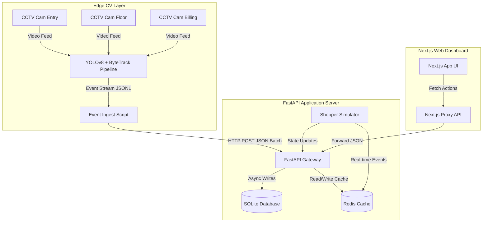

# System Architecture — VisionRetail IQ

This document details the architectural layout, components, data flows, and database schema for the VisionRetail IQ platform.

## Component Layout

VisionRetail IQ uses a modular, three-tier architecture designed for low latency, local edge reliability, and operational scalability:

## Component Responsibilities

### 1. Computer Vision Edge Pipeline (`pipeline/`)
* **Detection & Tracking**: Runs YOLOv8 object detection (class `0` - person) and ByteTrack association.
* **Staff Classification**: Leverages a fast HSV torso color matching algorithm to identify active store salespeople.
* **Direction Detection**: Implements a virtual tripwire on the entry camera to mark `ENTRY`/`EXIT` events.
* **Deduplication**: Suppresses overlapping camera tracks within 3-second windows, prioritizing the entry camera.
* **Re-ID Engine**: Connects returning visitors within 30 minutes via BB height signature checks, firing `REENTRY` events.

### 2. FastAPI Backend Service (`app/`)
* **Ingestion Gateway**: Receives batch POST events, validates schema constraints, and handles idempotency via unique UUID indexes.
* **Metrics Processor**: Computes KPIs (Unique footfall, zone dwells, queue thresholds, billing abandonment rates) dynamically.
* **AI Command Center**: Renders contextual, rule-based recommendations and daily summaries, ranking leaks by monetary value.
* **Real-time Simulator**: Manages active shopper counts and queue levels using Redis.

### 3. Next.js Dashboard Client (`frontend/`)
* **Digital Twin Visualization**: Renders responsive SVG maps of store layouts overlaying active occupancies, dead zones, and gold hotspot halos.
* **Interactive Tooltips**: Offers modal slideouts displaying zone-specific metrics (visits, dwell times, conversions).
* **Observability HUD**: Displays live camera statuses, frame rates, and anomaly warning banners.

## Data Models & Schema

The permanent data is persisted in SQLite with the following schema:

### `events` Table
Stores chronological telemetry events generated from cameras or the simulator:

| Field | Type | Modifiers | Description |
|---|---|---|---|
| `event_id` | VARCHAR(36) | PRIMARY KEY | Unique UUID v4 for idempotency checks. |
| `store_id` | VARCHAR(50) | INDEX | Identifier of the store (e.g. `STORE_MUM_001`). |
| `camera_id` | VARCHAR(50) | | ID of the source camera (e.g. `CAM_ENTRY_02`). |
| `visitor_id` | VARCHAR(50) | INDEX | Associated visitor ID (e.g. `VIS_abc123`). |
| `event_type` | VARCHAR(30) | | `ENTRY`, `EXIT`, `ZONE_ENTER`, `ZONE_EXIT`, `ZONE_DWELL`, `REENTRY`, `BILLING_QUEUE_JOIN`, `BILLING_QUEUE_ABANDON`. |
| `timestamp` | DATETIME | INDEX | ISO-8601 UTC timestamp. |
| `zone_id` | VARCHAR(50) | NULLABLE | Target area (e.g. `MAKEUP`). Null for ENTRY/EXIT. |
| `dwell_ms` | INTEGER | DEFAULT 0 | Milliseconds spent in zone (only for `ZONE_DWELL`). |
| `is_staff` | BOOLEAN | DEFAULT 0 | 1 if staff uniform matches, 0 if customer. |
| `confidence` | FLOAT | | Bounding box detection probability score. |
| `metadata` | TEXT | | JSON string containing `session_seq`, `sku_zone`, etc. |

### `audit_logs` Table
Maintains administrative audits and system triggers:

| Field | Type | Modifiers | Description |
|---|---|---|---|
| `id` | INTEGER | PRIMARY KEY | Auto-incrementing identifier. |
| `timestamp` | DATETIME | DEFAULT CURRENT_TIMESTAMP | Log capture time. |
| `user_role` | VARCHAR(50) | | Origin role (`API_GATEWAY`, `ADMIN`). |
| `action` | VARCHAR(100) | | Executed HTTP method or system operation. |
| `resource` | VARCHAR(255) | | Accessed endpoint URL path. |
| `metadata` | TEXT | | JSON metadata payload containing latency/traces. |

## Redis Caching & State Design

Redis serves as the dynamic state holder for real-time operations, keeping SQLite writes clean:

1. **Active Occupancy Tracking**: Tracks active `visitor_id`s currently inside the store to compute real-time counts.
2. **Queue Depth**: Holds current billing queue levels to avoid query-intensive table scans.
3. **Simulation Overrides**: Stores presenter-activated switches (e.g. `trigger_queue_spike`, `trigger_conversion_drop`) to update data flows instantly.
4. **Stale Feeds cache**: Keeps timestamps of last camera packets to trigger system warnings if edge hardware goes offline.
