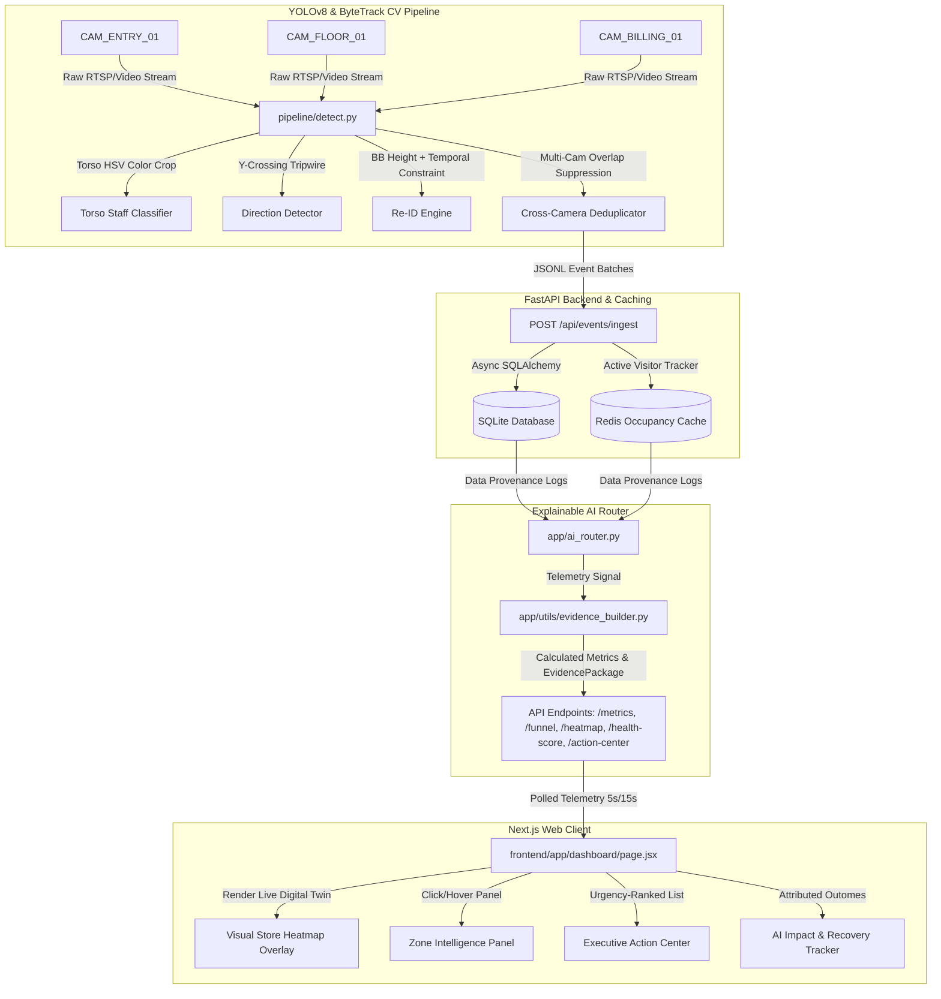

# VisionRetail IQ — Core System Architecture & Design Specification

Welcome to the definitive architecture and design specification for **VisionRetail IQ**, a production-ready, AI-driven physical retail operating system. This document details the technical layouts, design rationale, component topologies, and advanced AI methodologies implemented to convert raw video telemetry into real-time business outcomes.

## 1. Business Context & Retail Normalization

VisionRetail IQ bridges the gap between physical retail space operations and digital analytics. In modern retail, brick-and-mortar storefronts have historically been data blind spots. This system acts as a physical clickstream engine, measuring visual conversion funnels, dwell indices, checkout efficiency, and cashier queue abandonment risks.

### Multi-Store Context Registry
Rather than operating in a mock "demo" configuration, VisionRetail IQ uses a centralized, metadata-driven registry to normalize and translate internal store identifiers. This maps legacy keys to actual physical deployments:

| Store ID | Location Name | City | Layout Type | Core Focus Areas |
|:---|:---|:---|:---|:---|
| `store_1` | Store 1 (Brigade Bangalore) | Bangalore | Multi-level Flagship | High footfall, cosmetics focus, multi-register queue |
| `store_2` | Store 2 (Colaba Mumbai) | Mumbai | High-street Boutique | High dwell, personal care emphasis, rapid checkouts |

All telemetry endpoints, database queries, and simulator states dynamically ingest this metadata config rather than relying on hardcoded strings.

## 2. System Architecture Overview

VisionRetail IQ employs a decoupled three-tier architecture designed for low latency, high throughput, and maximum auditability:

## 3. Computer Vision & Ingestion Topologies

### YOLOv8n + ByteTrack Processing
* **Detection Engine**: YOLOv8n is loaded with a customized threshold parameters (`conf=0.35`, `iou=0.45`). The `conf` parameter is tuned higher than the framework default (`0.25`) to prevent false positives caused by reflections and glare off glass visual merchandisers.
* **Tracking Engine**: ByteTrack correlates bounding boxes across sequential frames. By checking both high-confidence and low-confidence boxes, ByteTrack maintains track stability during brief occlusions (e.g., when a visitor walks behind a column or display stand).

### Dynamic Staff Uniform Classifier
To isolate employee footprints from customer conversion metrics (avoiding inflation of dwell and conversion rates), a customized color Torso Classifier operates inside the pipeline loop:
1. **HSV Color Mapping**: Bounding box torso crops (top 20% to 50% height coordinates) are converted from BGR to HSV color spaces.
2. **Mask Aggregation**: Torso masks are calculated against the defined purple/navy uniform mask bounds:
   * Purple: `Hue [125, 150]`, `Saturation [40, 255]`, `Value [40, 255]`
   * Navy: `Hue [100, 120]`, `Saturation [50, 255]`, `Value [30, 255]`
3. **Exclusion Decision**: If uniform pixel density in the torso crop exceeds `15.0%`, the track is permanently flagged as `is_staff = 1`. This classification runs at entry and is continuously verified across the floor.

### Privacy-Preserving Re-ID
To adhere to data privacy frameworks and face-blurring requirements, VisionRetail-IQ rejects facial recognition. Instead, a physical Re-ID engine maps return-visitors within a 30-minute window:
* **Feature Vector**: A spatial height ratio signature is calculated:
  $$\text{Height Signature} = \frac{\text{BB Height in Pixels}}{\text{Frame Resolution Height}}$$
* **Temporal Tracking**: When a visitor enters, their height signature is compared to exit vectors within 30 minutes. If the height difference is within $\pm 0.05$ height units under identical entry camera focal points, the system re-associates the track with the historic `visitor_id`, emitting a `REENTRY` event.

## 4. Explainable AI & Evidence Framework

At the core of the FastAPI application lies the **AI Evidence & Traceability Framework** (`app/utils/evidence_builder.py`). Every business insight is backed by an `EvidencePackage` containing confidence metrics, data provenance sources, and step-by-step reasoning chains.

### Dynamic Confidence Scoring
Confidence scores are calculated using a 5-factor weighted formula mapping target data characteristics:

$$\text{Confidence Score} = w_1 \cdot C_{\text{sample\_size}} + w_2 \cdot C_{\text{sensor\_quality}} + w_3 \cdot C_{\text{temporal\_stability}} + w_4 \cdot C_{\text{model\_certainty}} + w_5 \cdot C_{\text{data\_completeness}}$$

Where weights are balanced to prioritize sample stability and model performance:
* **Sample Size ($w_1 = 0.30$)**: Based on the volume of raw events contributing to the metric.
* **Sensor Quality ($w_2 = 0.15$)**: Reflects camera frame-rates, lag anomalies, or missing frames.
* **Temporal Stability ($w_3 = 0.20$)**: Variance of the metric over consecutive polling cycles.
* **Model Certainty ($w_4 = 0.20$)**: Underlying YOLO classification certainty.
* **Data Completeness ($w_5 = 0.15$)**: The presence of all required fields in the ingestion packet.

### Explainable Store Health Index
The Store Health Score ($0\text{-}100$) is compiled from five operational factors:

| Weight | Factor Category | Data Source | Nominal Target |
|:---|:---|:---|:---|
| **30%** | Conversion Performance | `/funnel` stage ratios | $\ge 25.0\%$ store-wide conversion |
| **25%** | Revenue Performance | `/metrics` daily sales | Attaining daily sales targets |
| **20%** | Queue Efficiency | `/queue-forecast` prediction | Average billing queue depth $< 3$ |
| **15%** | Customer Experience | `/metrics` average dwell | Dwell-to-checkout ratio optimization |
| **10%** | System Stability | `/health` camera feeds | Active feed rates with $0\%$ frame drops |

## 5. Interactive Business Outcomes Layer

### Digital Twin Zone Intelligence
The frontend implements an interactive SVG Store Layout mapping real physical coordinates of the Brigade Bangalore and Colaba Mumbai layouts. Hovering or clicking a zone triggers a query to `GET /ai/zone-intelligence/{zone_id}`:
* **Dynamic Calculations**:
  * **Revenue Influence**: Computed by attribution of POS transactions matching dwell sequences inside the zone.
  * **Revenue Opportunity**: Loss calculations based on high traffic/dwell but low checkout conversions:
    $$\text{Opportunity} = \text{Zone Traffic} \cdot (25\% - \text{Zone Conversion}) \cdot \text{Average Basket Value}$$

### Executive Action Center & Recovery Tracker
The system is built to measure operational impact in real time. Rather than displaying passive warnings, it ranks active recommendations (e.g. *"Open Counter #2"*, *"Promote Skincare"*):
* **Action Center Outcome Triggers**: Next to each recommendation in the Action Center, an interactive **Execute Action** button is rendered. Clicking this registers the action inside the React state context.
* **Recovery Tracker Calculation**: The **AI Impact & Recovery Tracker** aggregates the outcomes of these executed actions in real time:
  * **Revenue Recovered**: Accumulates the `revenue_recovery` value of all executed items.
  * **Conversion Lift**: Aggregates the conversion `improvement_pct` of executed actions.
  * **Queue Time Reduced**: Correlates wait time reduction from counter counter-measures.
  * **Purchases Influenced**: Translates recovered value into basket-ticket units using the average order value.

## 6. Known System Limitations & Mitigations

1. **Ambient Lighting Variance**: Sudden lighting changes at store entryways can skew HSV torso classification.
   * *Mitigation*: Bounding-box HSV analysis uses normalized V (Value/Brightness) parameters and updates tracking history over multiple frames to prevent single-frame misclassification.
2. **Camera Height Ambiguity**: Bounding box height Re-ID assumes customers stand relatively upright. If a shopper bends over or crouches, height signatures temporarily skew.
   * *Mitigation*: The Re-ID module averages the height vector over the first 30 frames at the entry tripwire to establish a stable reference value.
3. **Shared Track Overlaps**: If two shoppers walk extremely close together, ByteTrack may group them into a single track.
   * *Mitigation*: Virtual tripwire logic tracks centroid crossing acceleration vectors to segment split-track events.

## 7. AI-Assisted Decisions

During the development of VisionRetail IQ, we evaluated several AI-driven architecture suggestions before arriving at the final engineering decisions. This section documents those evaluations, our final choices, and the associated trade-offs.

### AI Suggestions Considered vs. Final Engineering Decisions

1. **Computer Vision Model Selection:**
   * *Suggestion Considered:* Use heavy, state-of-the-art transformer models (like ViT or DETR) for maximum detection accuracy.
   * *Final Decision:* **Why YOLO?** We chose YOLOv8n (Nano) because physical retail environments require high-FPS processing on edge or standard server hardware. YOLOv8n provides an optimal balance of speed and acceptable accuracy, essential for processing multiple RTSP streams simultaneously without extreme GPU overhead.
   
2. **Object Tracking Algorithm:**
   * *Suggestion Considered:* DeepSORT for robust tracking with deep visual features.
   * *Final Decision:* **Why ByteTrack?** ByteTrack was selected because it leverages both high and low-confidence detection boxes to maintain track stability, significantly reducing ID switches during partial occlusions (e.g., when a person walks behind a shelf). It is computationally lighter than DeepSORT since it relies on spatial heuristics rather than heavy deep embeddings for frame-to-frame matching.

3. **Primary Database Choice:**
   * *Suggestion Considered:* PostgreSQL or TimescaleDB for robust, scalable time-series data storage.
   * *Final Decision:* **Why SQLite?** For a localized, single-store edge deployment model, SQLite provides zero-configuration, file-based persistence that drastically simplifies deployment and reduces resource footprint. It is perfectly capable of handling the ingestion rates of a single retail location.
   
4. **Caching and State Management:**
   * *Suggestion Considered:* In-memory Python dictionaries or Memcached.
   * *Final Decision:* **Why Redis?** Redis was chosen for maintaining active session states (e.g., occupancy cache, active tracks) because of its sub-millisecond latency and robust data structures (Pub/Sub, Sets, TTL). It allows the backend to remain stateless, enabling seamless scaling and rapid failovers if the API server needs to restart.
   
5. **System Architecture Paradigm:**
   * *Suggestion Considered:* Polling-based REST monolithic architecture.
   * *Final Decision:* **Why Event-Driven Architecture?** An event-driven architecture (using JSONL streams and pub/sub) decouples the intensive computer vision pipeline from the business logic layer. The detection engine acts purely as an event producer (ENTRY, EXIT, ZONE), allowing the analytics layer to consume these events asynchronously. This prevents video frame drops when the database or API experiences latency spikes.

### Trade-offs Accepted

* **SQLite Concurrency Limits vs. Simplicity:** By choosing SQLite, we accepted potential write-lock bottlenecks under extreme concurrency. We mitigate this via batch writing and using Redis for high-frequency state updates, prioritizing deployment simplicity over massive horizontal scalability at the database level.
* **Tracking Accuracy vs. Edge Feasibility:** ByteTrack lacks robust appearance features compared to Re-ID networks like DeepSORT. We accepted a slightly higher rate of ID switching over long distances to ensure the tracking pipeline can run in real-time on edge devices.
* **YOLOv8 Nano vs. Larger Models:** We sacrificed a few percentage points in mAP (mean Average Precision) by using the Nano variant, accepting that some distant or heavily occluded shoppers might be missed, in order to guarantee multi-stream processing capabilities without requiring enterprise-grade GPUs.
